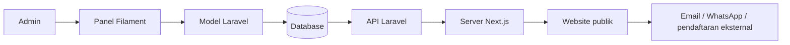
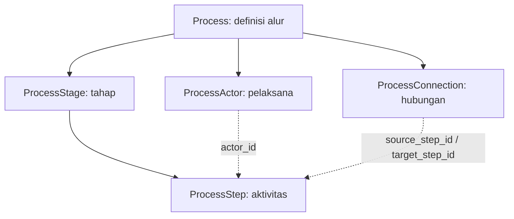

# Guidebook codebase LSP TIK Global

Panduan untuk pemula, diperbarui 1 Oktober 2026. Mulailah dari gambaran sistem dan satu alur data; Anda tidak perlu membaca seluruh file sekaligus.

## 1. Apa yang dibangun?

Proyek ini mempunyai dua aplikasi. **Frontend** adalah website yang dilihat pengunjung. **Backend** menyimpan konten dan menyediakan panel admin untuk mengelolanya. Keduanya dihubungkan melalui API, yaitu alamat yang mengembalikan data JSON.

Website menyediakan profil lembaga, katalog skema, direktori TUK dan asesor, galeri, mitra, serta panduan alur asesmen. Admin mengelola konten, pengguna admin, riwayat perubahan, dan ekspor.

Pendaftaran dari detail skema membuka tautan eksternal atau WhatsApp. Form kontak menyiapkan draf email/WhatsApp. Website belum menyimpan pendaftaran peserta, pembayaran, jadwal pribadi, hasil asesmen peserta, atau sertifikat peserta. Diagram asesmen menjelaskan prosedur umum; diagram tersebut bukan pelacakan status seorang peserta.



## 2. Istilah yang sering muncul

| Istilah | Arti dalam proyek |
| --- | --- |
| LSP | Lembaga Sertifikasi Profesi. |
| TUK | Tempat Uji Kompetensi; dikelola melalui model `Tuk`. |
| Asesor / asesi | Penilai kompetensi / peserta yang dinilai. Dalam diagram, keduanya merupakan jenis pelaksana. |
| Skema | Paket kompetensi beserta metode, biaya, unit, dan persyaratannya. |
| Unit kompetensi | Kemampuan tertentu yang termasuk dalam skema. |
| CMS | Panel untuk mengubah konten tanpa mengedit kode frontend. |
| Model | Kelas PHP yang mewakili data dan relasinya dalam database. |
| Controller | Penerima request API yang mengambil data untuk respons. |
| HTTP Resource | Pengubah model menjadi bentuk JSON untuk frontend. |
| Filament Resource | Definisi form, tabel, dan tindakan pengelolaan data admin. Berbeda dengan HTTP Resource. |
| Migration | File berurutan yang mengubah struktur database. |
| Seeder | Perintah pengisi data awal tertentu. Tidak semua seeder otomatis dijalankan. |
| Slug | Bagian URL yang mudah dibaca, misalnya `junior-coder`. |
| Relasi / foreign key | Hubungan antar-record, misalnya aktivitas memiliki tahap melalui `stage_id`. |
| Fallback | Konten pengganti saat data utama tidak tersedia. Penggunaannya saat ini dijelaskan dalam audit. |

## 3. Peta folder

| Lokasi | Isinya | Mulai membaca dari |
| --- | --- | --- |
| `frontend/src/app` | Halaman berdasarkan URL. `page.tsx` adalah halaman; `layout.tsx` membungkus halaman. | [Beranda](../src/app/page.tsx), [Informasi](../src/app/informasi/page.tsx) |
| `frontend/src/components` | Komponen tampilan dan interaksi, dikelompokkan per fitur. | [Katalog skema](../src/components/schemes/scheme-browser.tsx) |
| `frontend/src/lib` | Tipe data, pemuatan API, filter, validasi, dan tata letak diagram. | [Loader konten](../src/lib/content-api.ts), [logika skema](../src/lib/schemes.ts) |
| `frontend/src/app/globals.css` | Style bersama, warna, ukuran teks, header, footer, dan Beranda. | [Style global](../src/app/globals.css) |
| `*.module.css` | Style lokal untuk halaman/komponen; class diakses melalui `styles.nama`. | Folder komponen yang sedang diubah |
| `frontend/public` | Gambar, font, dan asset yang dapat diminta browser. | `public/figma`, `public/images` |
| `backend/routes` | Alamat API, route web, dan perintah console. | [Route API](../../backend/routes/api.php) |
| `backend/app/Http` | Controller, middleware, dan pengubah data JSON. | [ContentDirectoryController](../../backend/app/Http/Controllers/ContentDirectoryController.php) |
| `backend/app/Models` | Model, relasi, casts, validasi, dan pencatatan perubahan. | [CertificationScheme](../../backend/app/Models/CertificationScheme.php) |
| `backend/app/Filament` | Form, tabel, halaman, dan widget admin. | [CertificationSchemeResource](../../backend/app/Filament/Resources/CertificationSchemes/CertificationSchemeResource.php) |
| `backend/app/Providers` | Konfigurasi layanan dan panel. | [AdminPanelProvider](../../backend/app/Providers/Filament/AdminPanelProvider.php) |
| `backend/database` | Migration, factory untuk tes, dan seeder. | Migration yang terkait fitur |
| `backend/resources/data` | Data awal profil, organisasi, dan alur asesmen. | File JSON sesuai fitur |
| `backend/storage/app/public` | Berkas yang diunggah admin. | Dikelola melalui aplikasi, bukan diedit sebagai source |
| `backend/tests` | Tes API, CMS, integritas, media, audit, dan akses admin. | Tes dengan nama fitur yang sedang diubah |

Nama `figma` pada asset tidak berarti file tersebut merupakan sampah AI. Banyak gambar di folder ini masih dipakai sebagai logo atau gambar pengganti.

## 4. Menjalankan proyek

Gunakan terminal dari root repository. Versi yang digunakan untuk verifikasi adalah Node.js 24 dan PHP 8.5. Dependensi dikunci dalam `package-lock.json` dan `composer.lock`; gunakan file tersebut agar instalasi konsisten.

### Setup backend pada checkout baru

```bash
cd backend
composer install
cp .env.example .env
php artisan key:generate
[ -f database/database.sqlite ] || touch database/database.sqlite
php artisan migrate
php artisan storage:link
npm ci
npm run build
```

Lakukan penyalinan `.env` dan pembuatan key hanya saat setup baru. Pada workspace yang sudah berisi data, gunakan environment yang ada. `migrate` menerapkan perubahan yang belum dijalankan; `migrate:fresh` menghapus dan membuat ulang tabel, sehingga bukan langkah perbaikan rutin.

Backend default memakai SQLite. `.env.example` juga memakai database untuk session, cache, dan queue. `APP_URL` menjadi dasar URL media; `FRONTEND_URL` dipakai oleh tautan website dan preview dari admin.

Jalankan API dan panel:

```bash
php artisan serve --host=127.0.0.1 --port=8000
```

Panel tersedia pada path `/admin`. Jika sedang mengubah tema admin, jalankan `npm run dev` dari `backend/` di terminal terpisah. Frontend Next.js dan frontend tema admin menggunakan proses build yang berbeda.

### Akun admin

Buat akun secara interaktif, kemudian berikan akses kepada email akun tersebut:

```bash
php artisan make:filament-user
php artisan admin:grant admin@example.com
```

Ganti email contoh dengan akun yang dibuat. Pengguna baru tidak otomatis menjadi admin. `admin:grant` hanya mengubah akun yang sudah ada; model juga melindungi admin terakhir dari penghapusan/pencabutan akses. MFA berbasis aplikasi dan kode pemulihan tersedia melalui pengaturan akun, tetapi saat ini opsional.

### Setup frontend pada checkout baru

Buka terminal lain dari root repository:

```bash
cd frontend
npm ci
cp .env.example .env.local
npm run dev
```

Jika `.env.local` sudah ada, sesuaikan isinya tanpa menimpanya. Variabel `LANDING_API_URL`, `PROFILE_API_URL`, `ORGANIZATION_API_URL`, `CONTENT_API_URL`, dan `PROCESSES_API_URL` dipakai server Next.js untuk mengambil data Laravel. `LANDING_MEDIA_ORIGIN` mengizinkan origin gambar upload melalui konfigurasi Next.js. Jalankan ulang server setelah mengubah environment.

### Data awal

[DatabaseSeeder](../../backend/database/seeders/DatabaseSeeder.php) kosong. Sebagian migration sudah menambahkan konten Beranda, organisasi, dan satu TUK awal. Menjalankan `php artisan db:seed` saja tidak mengisi semua fitur.

Untuk menambahkan alur awal pada database pengembangan yang memang memerlukannya:

```bash
php artisan db:seed --class=AssessmentProcessSeeder
```

`AssessmentProcessSeeder` berhenti jika slug alur tersebut sudah ada, sehingga tidak mengembalikan edit admin ke versi awal. `OrganizationPositionSeeder` hanya mengisi tabel organisasi yang kosong. `TukSeeder` memastikan TUK Jobhun dan logo awal tersedia; bukan pengisi daftar seluruh TUK. Skema, asesor, dan galeri diisi melalui CMS. Data awal harus diperiksa sebelum dipakai sebagai informasi publik.

## 5. Membaca satu fitur dari awal sampai akhir

Contoh skema sertifikasi:

1. Admin membuka resource `CertificationSchemes` dan mengisi form.
2. `CertificationScheme` memvalidasi serta menyimpan data, seperti `methods`, `units`, dan `registration_url`.
3. Request `GET /api/content-directory` masuk ke `ContentDirectoryController::show()`.
4. Controller mengirim skema aktif yang memiliki slug. Nama database `basic_requirements` menjadi `basicRequirements` pada kontrak JSON.
5. `getPublicContent()` di Next.js mengambil respons dan membagikannya dalam request yang sama melalui React `cache`.
6. Halaman katalog memberikan data kepada `SchemeBrowser`; `selectSchemes()` menyaring, mengurutkan, dan membaginya ke halaman.
7. Detail mencari slug dari data CMS. `price=null` berarti biaya belum ditentukan; nilai `0` tetap harga yang valid.

`cache` pada loader ini menghindari pemuatan berulang dalam satu render/request, misalnya metadata dan isi detail. Ini bukan cache konten permanen. `connection()` dan `cache: 'no-store'` menjaga pemuatan saat request sehingga edit CMS tidak memerlukan build ulang frontend.

Beranda masih mengambil tiga kartu dari `scheme-samples.ts`, sedangkan katalog/detail memakai CMS. Perbedaan sumber tersebut merupakan gap yang tercatat dalam [audit](audit-sistem-ux.md), bukan pola yang perlu ditiru.

## 6. Data dan aturan yang perlu dipahami

### Konten halaman

`SitePage` menyimpan konten Beranda/Profil dalam kolom JSON `content`. JSON merupakan struktur bersarang berisi bagian seperti `hero`, `why_us`, `reviews`, `profile`, `vision`, dan `certificates`.

Editor menyimpan satu bagian setiap kali. `saveSection()` membaca ulang record setelah database lock, lalu mengganti bagian tersebut agar bagian lain tetap terjaga. Penyimpanan langsung menerbitkan perubahan. Tombol “Terapkan” pada modal fitur/sertifikat baru mengubah daftar di sesi; tombol simpan bagian tetap diperlukan.

`ProfilePageContentResource` membersihkan HTML sebelum frontend menampilkannya. Jangan menghapus sanitasi hanya karena penulis konten merupakan admin.

### Struktur organisasi

`OrganizationPosition.parent_id` menunjuk jabatan atasan. Posisi ditentukan oleh hubungan induk dan `order`, bukan koordinat manual. Model menolak hubungan melingkar. Induk nonaktif menyembunyikan seluruh cabangnya pada website publik. Bawahan harus dipindahkan/dihapus sebelum jabatan induk dapat dihapus.

### Alur asesmen



`type` pada aktivitas membedakan aktivitas biasa, keputusan, hasil, dokumen, awal, dan akhir. Koneksi dapat berupa normal, berhasil, atau revisi; hubungan revisi dapat kembali ke aktivitas sebelumnya.

Dua file bernama mirip mempunyai tugas berbeda:

- [HTTP ProcessResource](../../backend/app/Http/Resources/ProcessResource.php) menyusun JSON dan menyaring data nonaktif.
- [Filament ProcessResource](../../backend/app/Filament/Resources/Processes/ProcessResource.php) mendefinisikan pengelolaan alur di admin.

Endpoint publik menyembunyikan tahap, pelaksana, dan aktivitas nonaktif. Koneksi hanya dikirim jika kedua ujungnya masih terlihat. Preview menggunakan signed URL yang berlaku 10 menit dan menyertakan data nonaktif. Tautan preview perlu diperlakukan sebagai akses sementara kepada konten tersebut.

Frontend memvalidasi JSON melalui `parseAssessmentProcess()`, menata kartu melalui `layoutAssessmentProcess()`, lalu menggambarkannya dengan React Flow. ELK menentukan posisi di dalam jalur pelaksana; kode layout menangani pembungkusan tahap dan panah antarkartu. Jangan membuat koneksi bisnis dari hasil layout: hubungan yang ditampilkan harus tetap berasal dari API.

### Media dan transaksi

Galeri menggunakan Spatie Media Library dan model `Media`. `MediaObserver` membersihkan berkas upload ketika transaksi rollback dan menunda penghapusan berkas sampai commit. Menghapus berkas terlalu awal dapat membuat database kembali mereferensikan berkas yang sudah hilang.

Validasi model dalam `ValidatesContent` dan `ValidatesProcessRecords` juga berlaku saat penyimpanan dilakukan di luar form Filament. Query update langsung dapat melewati event model; jangan gunakan untuk perubahan konten rutin tanpa memahami konsekuensinya.

## 7. Server component dan client component

Halaman Next.js umumnya berjalan di server. Contohnya, `InformationPage` mengambil direktori dan alur secara bersamaan melalui `Promise.all` sebelum memberikan data ke komponen tampilan.

Komponen dengan `'use client'` menangani interaksi browser seperti filter, modal, zoom, dan state. `useState` menyimpan state interaksi; `useEffect` menyesuaikan perilaku setelah render, seperti pengembalian fokus atau pembersihan listener.

Tipe `ProcessResult`, `Scheme`, dan `DirectoryEntry` membantu editor memeriksa bentuk data. Tipe TypeScript tidak memvalidasi JSON dari jaringan secara otomatis; pemeriksaan payload tetap diperlukan pada batas API.

## 8. Di mana mengubah sesuatu?

| Kebutuhan | Lokasi pertama yang diperiksa |
| --- | --- |
| Mengubah teks/isi Beranda atau profil | Panel admin; model `SitePage` dan editor per bagian jika perilakunya perlu diubah |
| Mengubah kontak/WhatsApp | `frontend/src/lib/contact.ts`; nomor lisensi footer masih berada di `components/landing/chrome.tsx` |
| Mengubah pilihan filter skema | `frontend/src/lib/schemes.ts` dan `components/schemes/scheme-browser.tsx` |
| Mengubah tampilan kartu skema | `components/schemes/scheme-card.tsx` dan `schemes.module.css` |
| Menambah field skema | Migration → model/rules → form Filament → JSON controller → tipe/frontend → tes |
| Mengubah isi alur asesmen | CMS Alur Asesmen, bukan koordinat layout atau fixture tes |
| Mengubah tampilan/detail diagram | `assessment-process-flow.tsx` dan CSS pasangannya |
| Mengubah posisi/panah diagram | `assessment-process-layout.ts` dan tes layout |
| Mengubah izin admin | `User`, `AppServiceProvider`, middleware, dan tindakan Filament; baca tes akses terlebih dahulu |
| Mengubah upload/media | Resource Filament, konfigurasi storage, model media, observer, dan tes integritas media |

Saat menambah field, ikuti alurnya sampai tampilan. Menambahkan input admin tanpa memasukkan field ke respons JSON tidak akan membuatnya muncul di website.

## 9. Pengujian dan latihan pertama

Dari `frontend/`:

```bash
npm test
npm run lint
npm run build
```

Tes `.test.mjs` memakai test runner bawaan Node dan mengimpor TypeScript langsung. Tes mencakup filter, pagination, URL, draf kontak, pohon organisasi, validasi alur, serta geometri kartu/panah. Sebagian tes membuat server HTTP lokal sementara untuk memeriksa error dan timeout API.

Dari `backend/`:

```bash
php artisan test --compact
vendor/bin/pint --dirty --format agent
```

PHPUnit menggunakan SQLite `:memory:` berdasarkan `phpunit.xml`, bukan database operasional. Untuk perubahan khusus alur, mulai dari tes yang terkait:

```bash
php artisan test --compact --filter=Process
```

Latihan yang disarankan:

1. Baca satu kartu skema, lalu telusuri file frontend → loader → controller → model.
2. Pada database pengembangan, tambahkan satu skema melalui admin dan periksa apakah muncul pada katalog/detail. Isi slug dan status aktif.
3. Ubah satu label di komponen, jalankan lint/build, lalu periksa tampilan kecil dan desktop.
4. Buka tes `schemes.test.mjs`, pahami satu kasus filter, dan jalankan `npm test`.

Lakukan latihan pada lingkungan pengembangan. Latihan membaca kode tidak memerlukan reset database atau pengiriman pesan kepada pihak lain.

## 10. Troubleshooting

| Gejala | Periksa |
| --- | --- |
| Website tampil, katalog kosong | Backend berjalan, URL API benar, skema aktif dan memiliki slug. Loader saat ini juga memakai array kosong saat API gagal. |
| Skema di Beranda menghasilkan 404 | Beranda masih menggunakan contoh; pastikan skema tersedia di CMS. Baca temuan G01 dalam audit. |
| Foto upload tidak tampil | `storage:link`, `APP_URL`, izin storage, dan `LANDING_MEDIA_ORIGIN`; bandingkan URL media dengan konfigurasi. |
| Tema admin gagal karena manifest | Jalankan `npm ci` dan `npm run build` dari `backend/`. |
| Login berhasil tetapi panel ditolak | Pastikan akun existing sudah diberi akses melalui `admin:grant`. |
| Alur belum tersedia | Buat alur aktif melalui admin atau jalankan seeder alur pada database pengembangan yang memerlukannya. |
| Preview ditolak | Buat tautan baru dari admin; signature berubah atau masa berlaku dapat menyebabkan penolakan. |
| Kartu diagram tidak bisa diklik | Gap yang sudah dibuktikan: tombol mewarisi `pointer-events: none`. Detail masih dapat dibuka dengan keyboard; lihat G02 dalam audit. |
| Test runner frontend gagal membuka port | Tes fetch memerlukan izin server HTTP lokal sementara; bedakan kegagalan lingkungan dari assertion yang gagal. |
| Kontak tidak muncul pada inbox admin | Form publik hanya menyiapkan draf; belum ada endpoint penerimaan pesan website. |

## 11. Refaktor dan cleanup pada 1 Oktober 2026

Refaktor mempertahankan bentuk respons API dan aturan publikasi. Parser alur kini menggunakan nama helper yang menjelaskan tugasnya, blok validasi yang terpisah, dan parsing aktivitas yang mudah ditelusuri. Resource JSON dan form relasi admin diurai dari baris padat menjadi field yang terbaca. Layout diagram memakai satu indeks aktivitas untuk lookup koneksi dan menghapus `actorIndex` yang tidak pernah digunakan. Link peta dihitung sekali per baris.

Komentar ditambahkan pada aturan yang tidak tampak dari nama fungsi: penyaringan alur publik, lock penyimpanan bagian halaman, penghapusan cascade, scope pengurutan, cabang organisasi nonaktif, dan rollback berkas media. Komentar scaffolding yang hanya mengulang nama method dihapus.

| Yang dibersihkan | Alasannya |
| --- | --- |
| Log/snapshot `.playwright-mcp`, 89 screenshot di `frontend/artifacts`, cache `.impeccable` | Hasil pemeriksaan lokal, bukan source aplikasi. |
| Catatan `frontend/anti-slop`, rencana/ledger `docs/superpowers`, tiga audit lama | Digantikan audit kondisi saat ini dan panduan ini; sejumlah temuan lama sudah tidak berlaku. |
| `backend/.claude/skills`, file CLAUDE, hook `.codex/hooks.json` | Salinan skill identik, petunjuk setup lama/pointer, atau konfigurasi dengan path pribadi. |
| `DevelopmentPage`, `DesignButton`, `Divider`, CSS tombol desain | Tidak memiliki pemanggil; tampilan development tetap dipertahankan karena halaman Identity masih memakainya. |
| Override `canCreate` pada inbox dan default mitra lama di `SitePage` | Izin sudah diwarisi; mitra publik sekarang berasal dari TUK aktif. Data tersimpan tidak dimigrasikan/dihapus. |
| Script `check-assessment-cms` dan `check-scheme-detail` | Masih memakai asumsi login lama, password QA tetap, atau katalog contoh yang tidak sesuai CMS saat ini. |
| Unit `ExampleTest` yang hanya memeriksa `true` | Tidak menguji perilaku aplikasi. Tes fitur dan integritas tetap dipertahankan. |
| Cache Next.js/typecheck di root | Sisa sebelum aplikasi frontend ditempatkan di `frontend/`; dapat dibuat ulang. |

Cleanup menghapus 176 file redundan setelah menyimpan salinan sementara di `/tmp`. Salinan tersebut sudah tidak tersedia setelah restart lingkungan; jangan mengandalkannya untuk pemulihan. File yang sebelumnya dilacak Git dapat dipulihkan dari riwayat Git. Log baru dan screenshot lokal kini diabaikan Git.

`AGENTS.md`, skill backend pada `.agents`, konfigurasi Boost yang masih dipakai, dependency, asset website, fixture tes, migration, database, dan upload tetap tersedia. Perubahan lokal yang sudah ada tidak di-reset. Refaktor ini tidak menerapkan fitur UX baru; pekerjaan berikutnya dapat dipilih dari [audit sistem dan UX](audit-sistem-ux.md).
